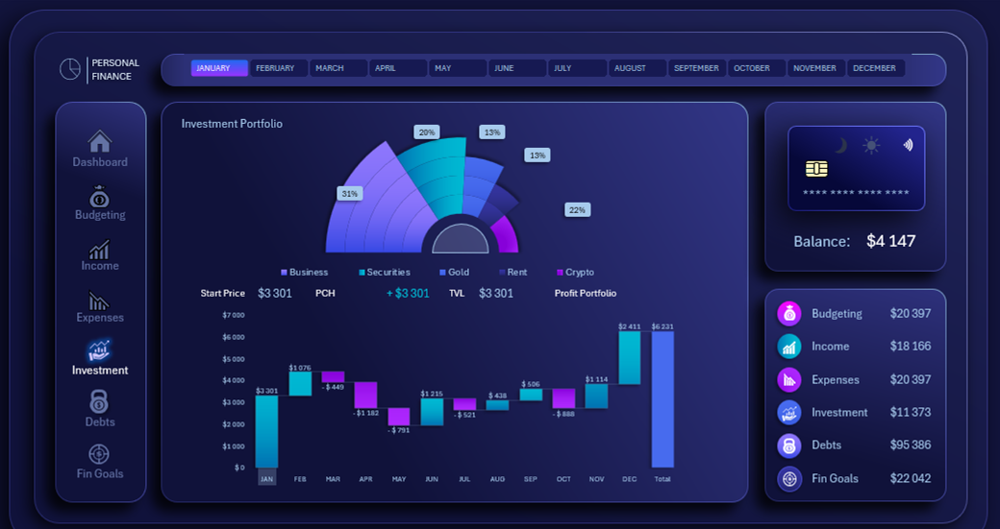
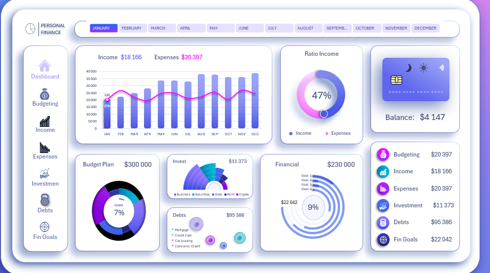
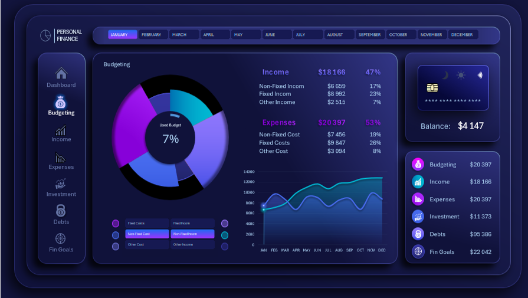
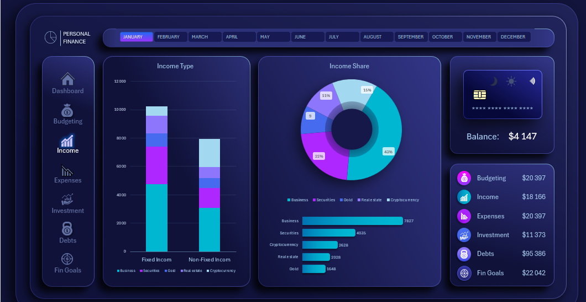
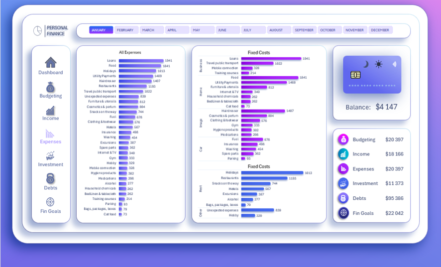
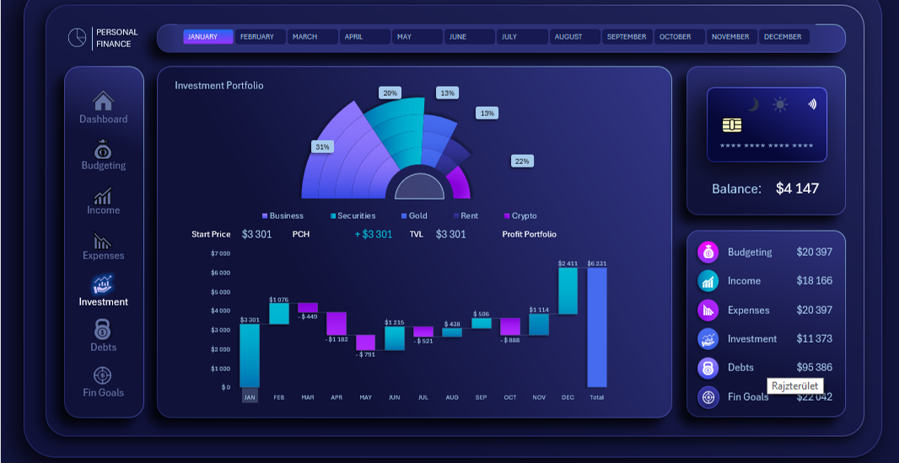
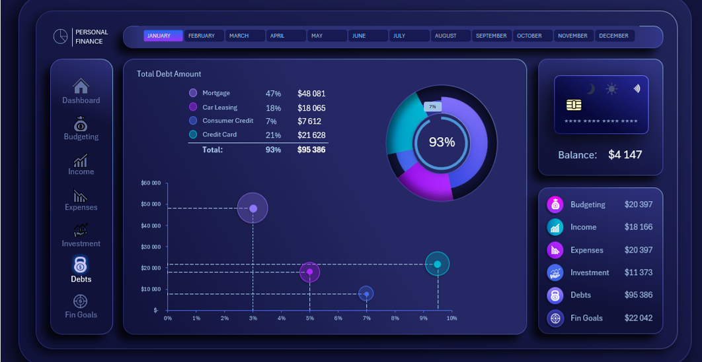
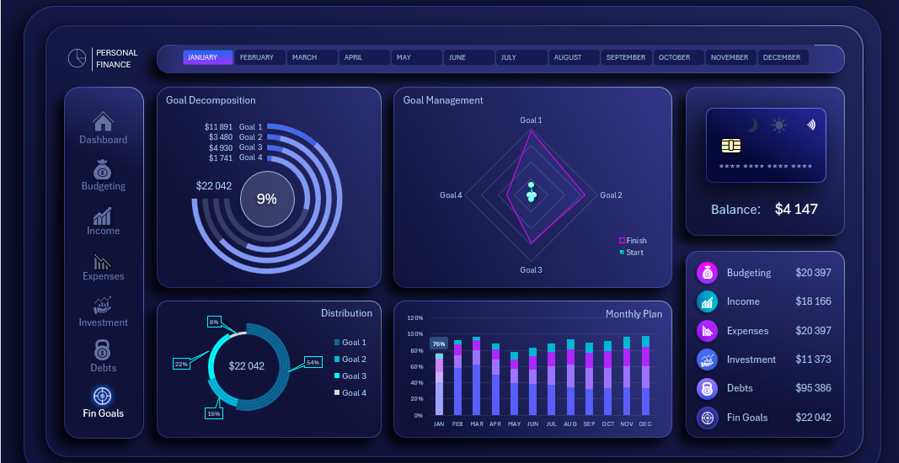

# Personal Finance Dashboard
### Financial Planning | Data Analysis | Dashboard Design | Microsoft Excel

## About the Project

I created this project to explore how personal finances can be organized and monitored in a simple, visual, and easy-to-understand way.

The idea was to bring different aspects of everyday financial management into one place, making it easier to see the bigger picture – from monthly income and expenses to investments, outstanding debts, and personal financial goals.

I wanted to create something that is not only practical from a financial perspective but also pleasant and straightforward to use.

## What You Can Find Inside

The workbook includes several dedicated sections:

- **Financial Overview:** A central dashboard showing key financial information and an overview of personal finances.
- **Budgeting:** An overview of financial planning and budget allocation.
- **Income & Expenses:** Tracking and comparing income sources and spending categories.
- **Investments:** An overview of different investment categories and portfolio values.
- **Debts:** Monitoring financial obligations, including loans, credit cards, and leasing.
- **Financial Goals:** Following progress towards individual savings and financial targets.

## Design & Development

I worked on both dark and light versions of the dashboard, exploring how different visual styles can influence readability and the overall user experience.

The design combines charts, visual indicators, contrasting colors, and clearly separated sections to make financial information easier to navigate.

I also structured the workbook into separate data, processing, and control sections, keeping the underlying information organized and the dashboard presentation clear.

## Tools & Skills

- Microsoft Excel
- Financial Planning & Budgeting
- Financial Data Organization
- Data Analysis
- Dashboard Development
- Data Visualization
- User-Oriented Design

## My Approach

What I particularly enjoyed about this project was bringing finance and design together.

Personal finance can involve a lot of different numbers, categories, and decisions. I wanted to explore how these could be presented in a more approachable way, helping users understand their financial situation without having to go through complicated spreadsheets.

For me, good financial tools should do more than display numbers. They should make information easier to understand and help people feel more confident about managing their finances.

This project reflects my interest in combining financial knowledge, analytical thinking, and creative problem-solving.

## Check out more images about the project

